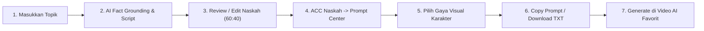

# 🎬 Promt Gambar & Video AI - TikTok & Shorts Co-Pilot

[](https://react.dev/)
[](https://vitejs.dev/)
[](https://tailwindcss.com/)
[](https://ai.google.dev/)
[](#)

Aplikasi co-pilot cerdas untuk konten kreator video pendek (**TikTok, Instagram Reels, dan YouTube Shorts**). Membantu Anda meriset fakta edukatif berbasis data ilmiah (*ground truth*), menyusun naskah per-scene yang memikat penonton dengan perpaduan bahasa daerah Nusantara, serta menghasilkan **Prompt Gambar** (*DALL-E 3 / Midjourney*) dan **Motion Prompt Video** (*Google FLOW / Kling AI / Luma Dream Machine / Sora / Runway*) siap pakai dalam format 9:16 vertikal.

---

## 📖 Deskripsi Proyek

Banyak konten video edukasi atau sejarah di media sosial terasa membosankan, terjebak pada mitos yang tidak terverifikasi, atau memiliki visual karakter yang generik dan rawan terkena sanksi hak cipta (*copyright strike*).

**Promt Gambar & Video AI** hadir sebagai solusi terpadu untuk:
1. **Riset Fakta Otentik Berstandar NotebookLM:** Menggali bukti nyata, kronologi, toponimi asli, dan membongkar mitos populer vs kenyataan sesungguhnya.
2. **Pelestarian Bahasa & Budaya Nusantara:** Menyelipkan kearifan dan kosakata bahasa lokal secara alami dengan rasio terukur (**60% Bahasa Indonesia : 40% Bahasa Daerah**).
3. **Karakter Lucu, Menggemaskan & Orisinal 100%:** Menghasilkan prompt karakter unik (*bespoke original IP*) dalam ragam estetika visual (seperti *Claymation/Stop-Motion* atau *3D Animation*) yang bebas dari filter pemblokiran merek dagang pihak ketiga.
4. **Efisiensi Alur Kerja:** Kreator tidak perlu lagi meraba-raba prompt; cukup unduh seluruh dossier naskah dan prompt dalam format `.TXT` dan gunakan langsung di AI generator video favorit Anda.

---

## 🌟 Fitur Unggulan

### 1. 🧠 AI Script & Scene Planner (Langkah 1)
- **Pipeline 2-Tahap Otomatis:**
  - *Tahap 1:* Riset fakta mendalam berbasis data ilmiah dan arsip sejarah.
  - *Tahap 2:* Pembagian naskah ke dalam scene berdurasi presisi (standar 10 detik per scene) lengkap dengan hook, visual cue, dan intonasi suara.
- **Setiap Scene Memiliki Properti Khusus:**
  - `narration`: Naskah voiceover siap baca yang memadukan bahasa nasional dan dialek daerah.
  - `voiceGuide`: Panduan tempo bicara (~115 kpm), jeda dramatis, dan emosi pengisi suara.
  - `sumberIlmu`: Catatan ilmiah/sejarah yang mendasari fakta scene tersebut.
  - `visual`: Deskripsi aksi karakter dan latar tempat otentik Indonesia.
  - `captionText`: Teks judul/hook subtitle untuk layar video.
- **Editor Naskah Fleksibel:** Tombol edit mandiri, hapus scene, tambah scene, hingga fitur *Sempurnakan Scene dengan Gemini AI*.

### 2. 🎨 Prompt Center (Langkah 2)
- **5 Pilihan Gaya Visual Karakter Unik:**
  - 🧸 **Claymation (Stop-Motion):** Boneka lempung plastisin lucu buatan tangan dengan tekstur guratan lembut.
  - ✨ **3D Animation (Cute Stylized):** Animasi 3D layar lebar bermata besar berbinar dan pipi chubby merona.
  - 🎨 **Anime Watercolor:** Ilustrasi cat air tradisional bernuansa hangat dan menyejukkan.
  - 📸 **Cinematic Hyperrealistic:** Sinematografi 8K natural dengan pencahayaan hangat khas pesisir tropis.
  - 🌙 **Dark Nusantara Folklore:** Sentuhan magis mitologi Nusantara berbalut ornamen batik dan cahaya temaram.
- **Salin 1-Klik Prompt Gambar & Motion Video:**
  - *Image Prompt:* Diformulasikan khusus untuk DALL-E 3, Midjourney, dan generator gambar (format vertikal `--ar 9:16`).
  - *Motion Prompt:* Diformulasikan dengan format bracket presisi `[Camera: ...] [Framing: 9:16] [Subject: ...] [Environment: ...] [Voiceover: ...] [Motion: ...]` untuk Google FLOW AI, Kling AI, Luma, Runway Gen-3, dan Minimax.
- **Audio TTS Tester:** Dengarkan sampel pembacaan narasi langsung dari browser.
- **Ekspor Dokumen Naskah:** Sekali klik tombol **Download Semua Prompt (.TXT)** untuk mengunduh seluruh naskah dan prompt ke satu berkas rapi.

---

## 🗺️ Integrasi Kamus & Falsafah 4 Suku Nusantara

Sistem dilengkapi ribuan kosakata kamus terverifikasi yang didistribusikan secara proporsional (**60% Bahasa Indonesia : 40% Bahasa Daerah**) pada 3 titik wajib: **Pembuka**, **Tengah Cerita**, dan **Penutup/CTA**:

| Suku / Daerah | Falsafah Luhur Utama | Kosakata Kunci & Contoh Ungkapan |
| :--- | :--- | :--- |
| **Suku Samawa**<br>*(Pulau Sumbawa / Tano Samawa)* | **Sabalong Samalewa** (Membangun seimbang lahir-batin)<br>**Mana tau manin tau** (Semua manusia setara) | *Melok rungan*, *Kalingka mo*, *tano*, *olat*, *jaran*, *tiu*, *let*, *bale*, *tode*, *kaji*, *sia*, *loka*, *sandro*, *balong*, *pina siq*. |
| **Suku Bugis**<br>*(Pesisir Sumbawa: Santong, Alas, Mapin)* | **Siri' na Pacce** (Harga diri & solidaritas empati)<br>**Taro Ada Taro Gau** (Satunya kata dan perbuatan) | *Tabe' puang eja!*, *Kurru sumange!*, *passompe*, *sompe'*, *bombang*, *lopi*, *mabbise*, *kukkedi*, *malessi*, *malempu'*, *yamaneng*. |
| **Suku Sasak**<br>*(Diaspora Lombok & Selat Alas)* | **Tindih** (Integritas luhur & keteguhan moral)<br>**Patuh Karya** (Musyawarah gotong royong) | *Ape arak batur sami!*, *Matur tampiasih*, *pelungguh*, *tiang*, *solah*, *nani*, *laeq*, *padu*, *becat*, *loeq*, *sekediq*, *tokol*. |
| **Suku Mbojo**<br>*(Bima & Dompu / Dana Mbojo)* | **Nggahi Rawi Pahu** (Kejujuran memegang janji)<br>**Maja Labo Dahu** (Malu dan takut berbuat cela) | *Mada*, *Ita*, *Wati*, *Londo*, seruan *Kone*, tradisi *Rimpu Cili*, tenun *Tembe Nggoli*, lumbung *Uma Lengge*. |

---

## 📱 Panduan Cara Penggunaan (Step-by-Step)



### Langkah 0: Menyiapkan Google Gemini API Key (Gratis)
1. Dapatkan API Key gratis di [Google AI Studio](https://aistudio.google.com/app/apikey).
2. Di dalam aplikasi, klik tombol **"Masukkan API Key"** di bagian header pojok kanan atas.
3. Masukkan API Key Anda, lalu klik **"Simpan & Aktifkan"**.
   *(Kunci disimpan secara aman di browser lokal Anda dan tidak akan pernah dikirimkan ke pihak manapun).*

### Langkah 1: Merancang Naskah (Layar 1 - Pembuat Scene)
1. **Masukkan Topik Cerita:**
   - Ketik topik yang ingin Anda buat (contoh: *"Asal Usul Labuan Teluk Santong"*, *"Misteri Hiu Paus Teluk Saleh"*, *"Legenda Lala Buntar"*, atau topik umum seperti *"Fakta Otak Manusia"*).
   - Atau klik salah satu tombol preset cepat yang tersedia.
2. **Tentukan Jumlah Scene:**
   - Pilih preset (5 scene, 10 scene, atau sesuaikan kebutuhan durasi video Anda).
3. **Klik Tombol "Riset & Susun Cerita Otomatis":**
   - AI akan menjalankan riset fakta objektif terlebih dahulu, kemudian menyusun naskah per-scene secara runtut dan mendalam.
4. **Tinjau dan Sesuaikan:**
   - Baca narasi per scene, panduan intonasi suara, dan sumber ilmu.
   - Jika ada kalimat yang ingin diperbaiki, klik ikon pensil (**Edit**) atau gunakan tombol **"Sempurnakan Scene dengan AI"**.
5. **Klik "ACC Naskah & Masuk ke Prompt Center":**
   - Naskah siap diproses ke tahap pembuatan visual!

### Langkah 2: Mengambil Prompt (Layar 2 - Prompt Center)
1. **Pilih Gaya Visual:**
   - Gunakan menu pilihan gaya (misal: *Claymation* untuk karakter lucu seperti animasi lempung, atau *3D Animation*).
   - Semua prompt gambar dan video otomatis diperbarui menyesuaikan gaya yang dipilih.
2. **Ambil Prompt Gambar (Image Prompt):**
   - Klik tombol **"Copy Prompt DALL-E"** di scene yang diinginkan.
   - Tempelkan ke DALL-E 3 (ChatGPT), Midjourney, atau Leonardo AI untuk menghasilkan gambar 9:16.
3. **Ambil Prompt Video Gerak (Motion Prompt):**
   - Klik tombol **"Copy Prompt FLOW"**.
   - Masukkan gambar yang sudah Anda buat tadi ke generator video (Google FLOW AI, Kling AI, Luma Dream Machine, atau Runway) lalu tempelkan Motion Prompt tersebut.
4. **Tandai Checklist:**
   - Centang kotak `[✓] Gambar DALL-E Selesai` dan `[✓] Video FLOW Selesai` untuk memantau progres pembuatan setiap scene.

### Langkah 3: Ekspor Naskah & Prompt Sekaligus
- Ingin mengolah video di software lain tanpa bolak-balik aplikasi?
  - Klik **"Salin Semua Prompt"** di bagian footer untuk menaruh seluruh naskah dan prompt ke clipboard.
  - Klik **"Download Semua Prompt (.TXT)"** untuk mengunduh satu berkas naskah lengkap yang siap dibagikan ke tim atau disimpan sebagai arsip konten.

---

## 🛠️ Instalasi & Menjalankan di Komputer Lokal

### Prasyarat
- [Node.js](https://nodejs.org/) versi 18 atau lebih baru.
- Git terpasang di komputer Anda.

### 1. Clone Repositori
```bash
git clone https://github.com/ElgaAlfarza/Promt-Gambar-Dan-Video-AI.git
cd Promt-Gambar-Dan-Video-AI
```

### 2. Instal Dependensi
```bash
npm install
```

### 3. Konfigurasi Kunci API (Opsional)
Salin berkas `.env.example` menjadi `.env`:
```bash
copy .env.example .env
```
Isi kunci API Gemini Anda di dalam file `.env`:
```env
GEMINI_API_KEY=masukkan_api_key_disini
VITE_GEMINI_API_KEY=masukkan_api_key_disini
VITE_GEMINI_MODEL=gemini-3.5-flash
```

### 4. Jalankan Aplikasi
Anda dapat mengklik dua kali file **`JALANKAN_PROJECT.bat`**, atau menjalankan perintah:
```bash
npm run dev
```
Buka browser dan akses alamat: `http://localhost:3000`.

---

## 🛡️ Kebijakan Keamanan & Privasi

- **Zero API Key Leak:** File `.env` dikecualikan secara ketat melalui `.gitignore` sehingga kunci pribadi Anda tidak akan pernah terpublikasi ke internet.
- **Bebas Hak Cipta Studio Pihak Ketiga:** Generator prompt dirancang khusus tanpa menggunakan nama studio pihak ketiga (bebas kata "Disney", "Pixar", "Ghibli") sehingga 100% aman dan lolos moderasi platform AI global.
- **Original Bespoke IP:** Karakter visual didesain orisinal murni (*one-of-a-kind bespoke design*), bukan tiruan figur publik maupun karakter berhak cipta milik orang lain.

---

## 📄 Lisensi
Project ini didistribusikan di bawah lisensi MIT. Silakan gunakan, pelajari, dan kembangkan untuk mendukung konten kreator Indonesia!
